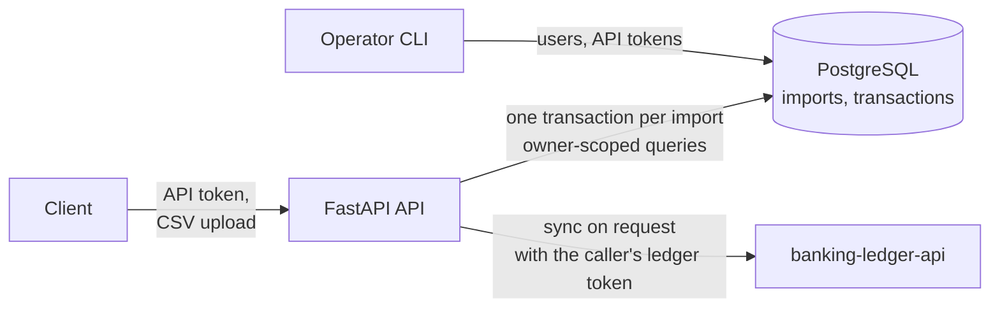

# Banking Transaction Analytics

[](https://github.com/felzov/banking-transaction-analytics/actions/workflows/ci.yml)

Import bank-statement transactions from CSV files or from a
[banking-ledger-api](https://github.com/felzov/banking-ledger-api) account, then validate,
deduplicate and total them per currency. Bad rows are reported without stopping the import,
re-uploading an overlapping statement adds nothing twice, and money is never a float.

> **Status: all eight planned phases are done.** A portfolio project, not used in production.
> One strict CSV dialect only, and the target users (accountants, bookkeepers, freelancers) are
> hypotheses that have not been validated. All data is synthetic.

**Stack:** Python 3.12+, FastAPI, Pydantic, SQLAlchemy 2 (async), PostgreSQL 17, Alembic, pytest,
Ruff, uv, GitHub Actions.

## Documentation

| Page | What it covers |
|------|----------------|
| [API reference](docs/api.md) | Authentication, every endpoint, amounts, totals and paging |
| [CSV format](docs/csv-format.md) | The supported CSV dialect and its row and file errors |
| [Ledger accounts](docs/ledger-accounts.md) | Syncing from banking-ledger-api, and its errors and settings |
| [Deployment](docs/deployment.md) | One server with systemd and Caddy, probes, logs, settings |
| [Development](docs/development.md) | Database, migrations, tests and the project layout |
| [Known limitations](docs/limitations.md) | What the project does not do |
| [Decisions](docs/adr/) | Ten ADRs |

## Architecture



- **A pure domain layer** parses and validates CSV with no I/O, so every money, date and
  description rule is unit-tested on its own.
- **Ownership is in the schema**: constraints tie every row to its owner, and every query is
  scoped to the authenticated user. Another user's data is a `404`.
- **A second source**: an account can take its transactions from banking-ledger-api instead of
  CSV. The ledger token is used for one sync and never stored.

## What it guarantees

- **Integer money.** Amounts are signed minor units (`-950.00` is `-95000`), never floats, and
  nothing is rounded: too many decimals is an error.
- **Partial imports.** Valid rows are stored, every invalid row is reported, all in one database
  transaction.
- **No duplicates on re-import.** Rows an account already holds are skipped and counted, and the
  same file cannot be imported twice.
- **No values in errors.** Error messages never echo the file or the request, because statements
  hold personal financial data.
- **Totals per currency.** Different currencies are never added together.

## Getting started

Requires Docker, [uv](https://docs.astral.sh/uv/) and GNU Make.

```bash
cp .env.example .env   # set a local-only password in POSTGRES_PASSWORD and both URLs
make install           # uv sync
make db-up             # start PostgreSQL on 127.0.0.1:5433
make db-migrate        # apply the migrations
make run               # the API on http://127.0.0.1:8000 (docs at /docs)
make check             # lint and unit tests (no database needed)
make check-all         # plus the integration tests
```

## Try it

With the database migrated and `make run` going, create a user and an API token with the
operator CLI:

```bash
uv run python -m transaction_analytics.cli create-user --name "Max"
# prints the user id
uv run python -m transaction_analytics.cli issue-token --user-id <user_id> --name laptop
# prints the token once (bta_…); it cannot be shown again
```

Create an account:

```bash
AUTH="Authorization: Bearer bta_…"
curl -s -X POST localhost:8000/accounts -H "$AUTH" -H 'Content-Type: application/json' \
  -d '{"name": "Current account"}'
# 201 {"id": "<account_id>", "name": "Current account", "source": "csv", "ledger": null, "created_at": "…"}
```

Upload a statement with 8 rows, 6 of them broken (a bad date, too many decimals, an unknown
currency, …):

```bash
ACCOUNT=<account_id>
curl -s -X POST localhost:8000/accounts/$ACCOUNT/imports -H "$AUTH" \
  -H 'Content-Type: text/csv' --data-binary @tests/fixtures/statement_mixed_errors.csv
```

```json
{"id": "<import_id>", "status": "completed", "total_rows": 8, "valid_rows": 2,
 "invalid_rows": 6, "duplicate_rows": 0, "imported_rows": 2, "error": null, "…": "…"}
```

The two valid rows are stored. See why the others were refused (row numbers count the header as
row 1, like a spreadsheet):

```bash
curl -s localhost:8000/imports/<import_id>/errors -H "$AUTH"
```

Upload the same file again: nothing is stored twice.

```bash
curl -s -X POST localhost:8000/accounts/$ACCOUNT/imports -H "$AUTH" \
  -H 'Content-Type: text/csv' --data-binary @tests/fixtures/statement_mixed_errors.csv
# 409 {"error": {"code": "duplicate_import", "message": "…"}}
```

Read the totals for September:

```bash
curl -s "localhost:8000/accounts/$ACCOUNT/summary?from=2026-09-01&to=2026-09-30" -H "$AUTH"
```

```json
{"account_id": "…", "from": "2026-09-01", "to": "2026-09-30",
 "totals": [{"currency": "GBP", "transactions": 2,
             "inflow_minor": 1500, "inflow": "15.00",
             "outflow_minor": -95000, "outflow": "-950.00",
             "net_minor": -93500, "net": "-935.00"}]}
```

Every amount comes twice: as integer minor units and as an exact decimal string. Interactive API
docs: <http://127.0.0.1:8000/docs>.

## License

[MIT](LICENSE)
